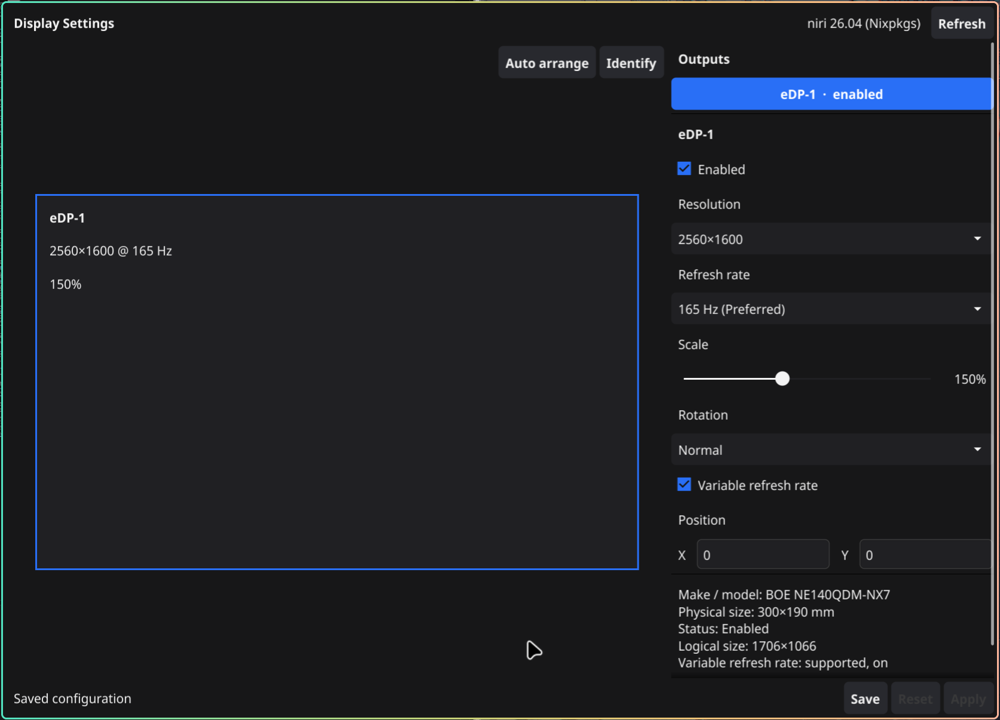

# Midori

Midori is a Linux/Wayland display-configuration GUI for the [niri](https://github.com/niri-wm/niri) compositor. It inspects connected outputs, edits their settings, and applies changes as a single reversible runtime transaction, so a bad change cannot leave the desktop unusable.

Hyprland support is future work.



## Features

- Lists every connected output with its mode, refresh rate, scale, transform, position, enabled state, and variable refresh rate support.
- Arrangement canvas with drag positioning in logical pixels, edge snapping, overlap rejection, numeric X/Y entry, auto-arrange, and temporary identify overlays.
- Inspector editing for mode, scale (0.5–3.0), rotation, position, enablement, and VRR.
- Safe apply: a 15-second confirmation countdown with automatic revert on timeout, explicit revert, or window close.
- Best-effort rollback on partial apply failure.
- Hotplug detection by polling outputs every 3 seconds, plus lost-connection and recovery states.
- Backend-independent UI built on `internal/display`; niri uses direct JSON IPC on `$NIRI_SOCKET`.
- No compositor configuration files are read or written. No root privileges, network access, or telemetry.

## Requirements

- Linux/Wayland with niri `26.04` or newer.
- Go `1.24.0` or newer, CGO enabled, and a C compiler.
- Fyne system dependencies (Wayland, OpenGL, X11 dev headers).

Debian/Ubuntu:

```sh
sudo apt-get install golang gcc libgl1-mesa-dev xorg-dev libwayland-dev libxkbcommon-dev
```

Fedora:

```sh
sudo dnf install golang golang-misc gcc libXcursor-devel libXrandr-devel mesa-libGL-devel libXi-devel libXinerama-devel libXxf86vm-devel libxkbcommon-devel wayland-devel
```

Arch:

```sh
sudo pacman -S go xorg-server-devel libxcursor libxrandr libxinerama libxi wayland libxkbcommon
```

The `wayland` build tag is mandatory: Fyne's default Linux build targets X11 and cannot open a window under a pure niri session.

## Build

```sh
CGO_ENABLED=1 go build -tags wayland -trimpath -o bin/midori ./cmd/midori
```

Run from source:

```sh
go run -tags wayland ./cmd/midori
```

Flags:

```text
--backend auto|niri|hyprland   backend to use (default auto)
--debug                        enable debug logging on stderr
--version                      print the version and exit
```

Tests and checks:

```sh
go test ./...
go test -race ./...
go vet ./...
gofmt -l .
```

## Install and package

Install to `~/.local` (override with `PREFIX`):

```sh
./scripts/install.sh
```

Build a versioned `tar.xz` bundle under `dist/`:

```sh
VERSION=0.1.0 ./scripts/package.sh
```

## Documentation

- [Documentation index](docs/README.md)
- [Product scope](docs/product.md)
- [Architecture](docs/architecture.md)
- [niri backend](docs/backends/niri.md)
- [Development guide](docs/development.md)
- [Roadmap](docs/roadmap.md)
